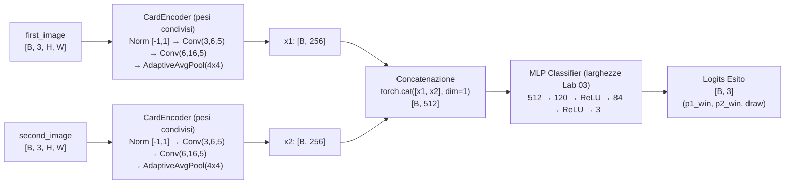

# Approccio B — Baseline Neurale (`feature/baseline`)

Questo documento descrive la struttura software, le scelte architetturali e il protocollo operativo dei moduli sviluppati nel branch `feature/baseline` per l'**Approccio B (Baseline puramente neurale)** e i mattoni condivisi con l'**Approccio A (DeepProbLog)**.

---

## 1. Obiettivo dell'Approccio B

Date due immagini di carte $(I_1, I_2)$, il modello predice direttamente l'esito del duello tra le 3 classi condivise in `OUTCOME_CLASSES` (`0: p1_win`, `1: p2_win`, `2: draw`) **senza conoscere a priori le regole del gioco** e **senza ricevere alcuna supervisione sui semi delle singole carte**.

La rete deve quindi apprendere dai soli esempi $(I_1, I_2, \text{outcome})$:
1. **La percezione visiva** (distinguere Cuori, Fiori e Picche ignorando il rango della carta).
2. **La regola relazionale ciclica** ($\text{Hearts} > \text{Clubs} > \text{Spades} > \text{Hearts}$ e semi uguali $\to \text{Draw}$).

---

## 2. Mappa dei File Creati nel Branch

```text
CardSeedDuel/
|-- src/card_suit_duel/models/
|   |-- __init__.py            # Esportazione pubblica di encoder, SuitNet, BaselineDuelNet, cache, trainer e metriche
|   |-- encoder.py             # CardEncoder (CNN stile Lab 03) + SuitClassifier e SuitNet (256->120->84->3 + Softmax) per Approccio A
|   |-- baseline.py            # Architettura siamese a due carte (BaselineDuelNet) per Approccio B
|   |-- baseline_trainer.py    # CardTensorCache condivisa, CachedCardPairDataset + loop a 5 passi, sync CUDA, early stopping opzionale
|   `-- metrics.py             # Accuracy, Macro-F1, Confusion Matrix, diagnostica 9 semi, aggregazione multi-seed e collect_hardware_info()
|-- scripts/
|   `-- train_baseline.py      # Script CLI (--evaluate-test OFF di default, --seeds, --patience, pre-warm cache, blocco hardware)
|-- tests/
|   `-- test_baseline.py       # Test unitari su architetture, SuitNet, cache, hardware, metriche e trainer
`-- docs/
    |-- BASELINE_APPROACH_B.md # Questo documento
    `-- SCHEMA_APPROCCI_A_E_B.md
```

*(Nessun file della cartella `src/card_suit_duel/data/` di Franco è stato modificato).*

---

## 3. Architettura Neurale e Riferimenti ai Laboratori (`encoder.py` e `baseline.py`)

* **Dal Lab 01 (`lab1-bp-nn.ipynb`):** il ciclo di addestramento PyTorch in **5 passi** (`zero_grad -> forward -> loss -> backward -> step`), `model.eval()` / `torch.no_grad()` e la motivazione teorica sul limite delle reti pure nell'apprendere regole logiche non-lineari (nel Lab 01 studiata sulla parità a 10 bit con `DeepMLP_pytorch`: `n_inputs -> 16 -> 8 -> 1` con Sigmoide).
* **Dal Lab 03 (`lab3-deepproblog.ipynb`):** l'architettura modulare `MNIST_Net` (`Conv2d(c_in, 6, 5) -> MaxPool2d(2, 2) -> ReLU -> Conv2d(6, 16, 5) -> MaxPool2d(2, 2) -> ReLU` → `16 * 4 * 4 = 256` feature), la normalizzazione `(pixel - 0.5) / 0.5` in `[-1, 1]` e la testa MLP `120 -> 84 -> n` (`MNIST_Classifier`, ripresa con la stessa struttura anche nel Lab 04 `Net` e nel Lab 05 `MNIST_Net`).



### 3.1 `CardEncoder`, `SuitClassifier` e `SuitNet` (`src/card_suit_duel/models/encoder.py`)
* **`CardEncoder`:** adatta l'encoder del **Lab 03** da 1 a **3 canali RGB**, applica `(images - 0.5) / 0.5` e termina con `AdaptiveAvgPool2d((4, 4))` → vettore di **`256` feature** per qualsiasi risoluzione ($\ge 28 \times 28$).
* **`SuitClassifier` & `SuitNet` (pronti per l'Approccio A):** usano esattamente `CardEncoder` seguito da `256 -> 120 -> ReLU -> 84 -> ReLU -> 3` + **`Softmax(dim=1)`** sulle 3 classi in `SUIT_CLASSES` (`hearts, clubs, spades`), identici a `MNIST_Classifier` e `MNIST_Net` del Lab 03.

### 3.2 `BaselineDuelNet` (`src/card_suit_duel/models/baseline.py`)
* Applica la stessa istanza di `CardEncoder` a `first_image` e `second_image` (pesi condivisi), concatena `[x1, x2]` (`512` feature) e li passa alla testa `512 -> 120 -> ReLU -> 84 -> ReLU -> 3` (logits grezzi per `nn.CrossEntropyLoss`).
* **Parametri allenabili:** **`74.851`**.

---

## 4. Cache Pre-caricata, Misure dei Tempi e Hardware (`baseline_trainer.py` e `metrics.py`)

### 4.1 `CardTensorCache` e `CachedCardPairDataset`
* **`CardTensorCache`** è una cache in RAM condivisibile **identica** tra Approccio A (`CardImages`) e Approccio B (`CachedCardPairDataset`), garantendo stessa decodifica, stesso resize e stessa normalizzazione.
* Prima dell'inizio del training, `scripts/train_baseline.py` chiama `prewarm_cache()` su `train` e `valid` e registra il tempo separatamente nel `summary.json` sotto **`cache_seconds`** (`cache_details.train_seconds`, `cache_details.valid_seconds`, `cache_details.test_seconds`).
* In questo modo `elapsed_seconds` di ogni epoca e `total_training_seconds` misurano **solo forward, backward e aggiornamento pesi**, senza l'overhead di decodifica JPEG nella prima epoca.
* Se `device` è `cuda`, `_sync_device()` invoca **`torch.cuda.synchronize(device)`** prima e dopo la misura temporale.

### 4.2 Blocco `hardware`, Diagnostica e Metriche (`metrics.py`)
* `collect_hardware_info(device)` registra nel `summary.json`: `device`, `platform`, `processor`, `python_version`, `cpu_count`, `torch_num_threads`, `torch_version`, `cuda_available`, `cuda_version` e `gpu_name`.
* `compute_classification_metrics`, `compute_suit_pair_accuracy` (diagnostica post-hoc sulle 9 combinazioni di semi senza mai esporre i semi al training), `aggregate_metric_runs` (media/std multi-seed), `ms_per_pair` (velocità di inferenza) e `count_trainable_parameters` sono riutilizzabili identici da Approccio A e B.
* `fit_baseline` supporta anche `patience: int | None = None` (early stopping opzionale, disattivato di default).

---

## 5. Protocollo sul Test Set e Comandi

> ⚠️ **Regola metodologica sul Test Set:** di default `scripts/train_baseline.py` **non carica né valuta il test set** (`--evaluate-test` è disattivo di default). Dimensione delle immagini, numero di epoche e iperparametri vanno scelti **esclusivamente su `valid`** (e concordati con Approccio A). Il flag `--evaluate-test` va attivato **una sola volta a fine lavoro** per la valutazione finale sui 3 subset `20% / 50% / 100%` con configurazione identica.

### Eseguire i test unitari
```powershell
.venv\Scripts\python.exe -B -m unittest discover -s tests -p "test_*.py"
```

### Tuning / sviluppo (solo `train` e `valid`, test NON toccato)
```powershell
# Singolo seed
.venv\Scripts\python.exe scripts\train_baseline.py --percentage 20 --image-size 64 --epochs 25 --batch-size 64 --lr 0.001 --seed 42

# Multi-seed con riepilogo media +/- std e diagnostica 9 combinazioni di semi
.venv\Scripts\python.exe scripts\train_baseline.py --percentage 20 --seeds 0 1 2 --image-size 64 --epochs 25 --batch-size 64 --lr 0.001
```

### Valutazione finale (una sola volta, a configurazione concordata con Approccio A)
```powershell
.venv\Scripts\python.exe scripts\train_baseline.py --percentage 20  --image-size 64 --epochs <N> --batch-size 64 --lr 0.001 --seed 42 --evaluate-test
.venv\Scripts\python.exe scripts\train_baseline.py --percentage 50  --image-size 64 --epochs <N> --batch-size 64 --lr 0.001 --seed 42 --evaluate-test
.venv\Scripts\python.exe scripts\train_baseline.py --percentage 100 --image-size 64 --epochs <N> --batch-size 64 --lr 0.001 --seed 42 --evaluate-test
```

---

## 6. Stato degli Esperimenti (20% / 50% / 100%, solo Validation)

Tutti i run esplorativi riportati finora hanno mantenuto **`test_evaluated: false`** (test set mai toccato, `image_size=64×64`, `batch_size=64`, `lr=0.001`, CPU):

| Frazione Train | Configurazione esplorativa | Best Valid Macro-F1 | Note tempi / diagnostica |
| :---: | :--- | :---: | :--- |
| **20%** (`6k` coppie) | `25` epoche, **3 seed (`0, 1, 2`)** | **`0.7626 ± 0.0300`** *(best `0.8046`)* | `cache_seconds = 8.83 s` (unica), train medio `49.1 s`, inferenza `0.161 ms/coppia`; errore residuo su `clubs` vs `spades` (`~67%–69%`) |
| **50%** (`15k` coppie) | `25` epoche, seed `42` | **`0.8516`** *(ep. 24)* | Curva di scalabilità netta rispetto al 20% |
| **100%** (`30k` coppie) | `15` epoche, seed `42` | **`0.9207`** *(ep. 11)* | `cache_seconds = 11.06 s`, train `182.6 s` (`~12.2 s/ep.`) |

I **risultati finali sul test set** verranno eseguiti e registrati **una sola volta** sui tre subset **`20% / 50% / 100%`** con `--evaluate-test` dopo aver concordato la configurazione definitiva con l'Approccio A.
