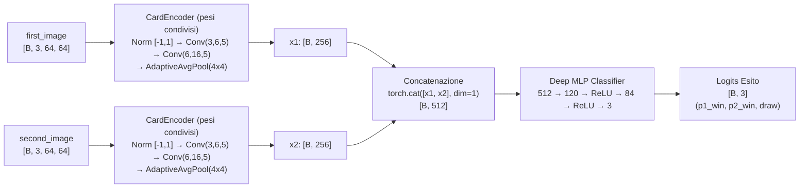

# Approccio B — Baseline Neurale (`feature/baseline`)

Questo documento descrive la struttura software, le scelte architetturali e il funzionamento dei moduli sviluppati nel branch `feature/baseline` per implementare l'**Approccio B (Baseline puramente neurale)** previsto dalla traccia di *CardSeedDuel*.

---

## 1. Obiettivo dell'Approccio B

Date due immagini di carte $(I_1, I_2)$, il modello predice direttamente l'esito del duello tra le 3 classi condivise in `OUTCOME_CLASSES` (`0: p1_win`, `1: p2_win`, `2: draw`) **senza conoscere a priori le regole del gioco** e **senza ricevere alcuna supervisione sui semi delle singole carte**.

La rete deve quindi apprendere contemporaneamente dai soli esempi $(I_1, I_2, \text{outcome})$:
1. **La percezione visiva** (distinguere Cuori, Fiori e Picche ignorando il valore/figura della carta).
2. **La regola relazionale ciclica** ($\text{Hearts} > \text{Clubs} > \text{Spades} > \text{Hearts}$ e semi uguali $\to \text{Draw}$).

---

## 2. Mappa dei File Creati nel Branch

```text
CardSeedDuel/
|-- src/card_suit_duel/models/
|   |-- __init__.py            # Esportazione pubblica di classi, trainer e metriche
|   |-- encoder.py             # Blocco visivo CNN (CardEncoder) fedele al Lab 03
|   |-- baseline.py            # Architettura a due carte + MLP (BaselineDuelNet)
|   |-- baseline_trainer.py    # Cache tensori in RAM + loop di training/validazione a 5 passi
|   `-- metrics.py             # Calcolo Accuracy, Macro-F1, Confusion Matrix e conteggio parametri
|-- scripts/
|   `-- train_baseline.py      # Script CLI per addestrare e valutare la Baseline su 20/50/100%
|-- tests/
|   `-- test_baseline.py       # 8 test unitari su architetture, metriche e discesa della loss
`-- docs/
    `-- BASELINE_APPROACH_B.md # Questo documento
```

---

## 3. Architettura Neurale (`encoder.py` e `baseline.py`)

L'architettura riprende fedelmente i mattoni visti nei laboratori del corso (**Lab 01** per il `DeepMLP` e **Lab 03 / 04 / 05** per l'encoder convoluzionale in stile LeNet):



### 3.1 `CardEncoder` (`src/card_suit_duel/models/encoder.py`)
Adatta l'encoder di `MNIST_Net` del **Lab 03** da 1 canale (scala di grigi) a **3 canali RGB**:
1. **Normalizzazione in ingresso:** trasforma i pixel da $[0, 1]$ a $[-1, 1]$ tramite `(images - 0.5) / 0.5` (equivalente a `transforms.Normalize((0.5,), (0.5,))` del Lab 03). Questo passaggio è fondamentale perché le carte hanno uno sfondo prevalentemente bianco ($\approx 1.0$) e centrarle attorno a $0$ evita la saturazione iniziale dei neuroni.
2. **Blocco Convoluzionale 1:** `Conv2d(3, 6, kernel_size=5) -> MaxPool2d(2, 2) -> ReLU(True)`.
3. **Blocco Convoluzionale 2:** `Conv2d(6, 16, kernel_size=5) -> MaxPool2d(2, 2) -> ReLU(True)`.
4. **Adattamento Spaziale:** `AdaptiveAvgPool2d((4, 4))` seguito da `view(-1, 16 * 4 * 4)` produce sempre un vettore di **`256` feature** per ogni carta, indipendentemente dalla risoluzione scelta (`64×64`, `128×128` o `224×224`).

### 3.2 `BaselineDuelNet` (`src/card_suit_duel/models/baseline.py`)
1. **Estrazione a pesi condivisi (Siamese):** applica la **stessa istanza** di `CardEncoder` sia a `first_image` ($x_1 \in \mathbb{R}^{B \times 256}$) sia a `second_image` ($x_2 \in \mathbb{R}^{B \times 256}$).
2. **Concatenazione:** unisce le feature delle due carte in un unico vettore $x = [x_1, x_2] \in \mathbb{R}^{B \times 512}$.
3. **Testa `DeepMLP` (`self.classifier`):** segue la struttura `120 -> 84 -> n` dei laboratori:
   * `Linear(512, 120) -> ReLU()` (con `Dropout` opzionale)
   * `Linear(120, 84) -> ReLU()`
   * `Linear(84, 3)`
4. **Uscita:** restituisce i **3 logits grezzi** (senza Softmax, poiché `nn.CrossEntropyLoss` applica internamente `LogSoftmax + NLLLoss`).
5. **Parametri totali allenabili:** **`74.851`**.

---

## 4. Training Loop, Caching e Metriche (`baseline_trainer.py` e `metrics.py`)

### 4.1 `CachedCardPairDataset`
* Eredita da `CardPairDataset` mantenendo **invariati tutti i controlli sul contratto dati**.
* Poiché migliaia di coppie riutilizzano le stesse carte (es. le `3.000` coppie di `valid` provengono da sole `195` immagini distinte), memorizza in un dizionario in RAM il tensore `[3, H, W]` già trasformato al primo accesso di ogni `image_id`.
* **Impatto sui tempi:** riduce il tempo di un'epoca di training (al 20%) da `~52 s` a **`~4.9 s`** e la validazione da `~24 s` a **`~1.15 s`**.

### 4.2 Ciclo di Training a 5 Passi (`train_one_epoch`, `evaluate_baseline`, `fit_baseline`)
* **`train_one_epoch`:** implementa i 5 passi canonici del **Lab 01**:
  1. `optimizer.zero_grad()`
  2. `logits = model(first_image, second_image)`
  3. `loss = loss_fn(logits, targets)` (`nn.CrossEntropyLoss()`)
  4. `loss.backward()`
  5. `optimizer.step()`
* **`evaluate_baseline`:** valuta un `DataLoader` con `model.eval()` e `with torch.no_grad():`.
* **`fit_baseline`:** addestra per `epochs` epoche con `torch.optim.Adam`, salva una copia dei pesi (`best_state_dict`) ogni volta che migliora la **Macro-F1 su `valid`** (usando la validation loss come spareggio) e ripristina automaticamente il miglior modello a fine addestramento.

### 4.3 Metriche (`src/card_suit_duel/models/metrics.py`)
Modulo indipendente e riutilizzabile anche dall'Approccio A:
* `compute_confusion_matrix`: matrice $3 \times 3$ con righe = classe reale e colonne = classe predetta.
* `compute_classification_metrics`: calcola `accuracy`, `macro_f1`, `macro_precision`, `macro_recall` e i valori `precision / recall / f1 / support` per ciascuno dei 3 esiti (`p1_win`, `p2_win`, `draw`).
* `count_trainable_parameters`: conta il numero di parametri con `requires_grad=True`.

---

## 5. Come Eseguire i Test e l'Addestramento

### Eseguire i test unitari della Baseline
```powershell
.venv\Scripts\python.exe -B -m unittest tests/test_baseline.py -v
```

### Avviare un addestramento da riga di comando
```powershell
# Esempio: training sul 20% dei dati, immagini 64x64, 25 epoche, batch size 64
.venv\Scripts\python.exe scripts\train_baseline.py --percentage 20 --image-size 64 --epochs 25 --batch-size 64 --lr 0.001
```
Lo script salva automaticamente in `results/runs/baseline/<run_id>/`:
* `best_model.pt` (pesi del miglior checkpoint su `valid`)
* `summary.json` (iperparametri, storico epoca per epoca, tempi e metriche finali sul test set).

---

## 6. Analisi Sperimentale Preliminare (20% Train, 25 Epoche)

Eseguendo 25 epoche sul subset al **20%** (`6.000` coppie train, `3.000` valid, `3.000` test, `64×64`), la Baseline mostra una caratteristica **curva di apprendimento a due gradini**:

| Fase | Epoche | Train Acc | Valid Acc | Valid Macro-F1 | Interpretazione |
| :--- | :---: | :---: | :---: | :---: | :--- |
| **Stallo iniziale** | 1 – 4 | `32.7%` | `33.33%` | `0.1667` | Punto di sella $\ln(3) \approx 1.0986$: ogni carta singola ha informazione mutua nulla con l'esito |
| **1° Gradino** | 5 – 10 | `34.3% → 53.5%` | `37.2% → 50.97%` | `0.4936` | L'encoder impara a separare **Cuori (rosso)** da **Fiori/Picche (neri)** |
| **2° Gradino** | 11 – 20 | `55.3% → 85.8%` | `53.6% → 77.07%` | **`0.7707`** | L'encoder distingue **Fiori vs Picche** e l'MLP apprende la regola ciclica |
| **Overfitting** | 21 – 25 | `87.4% → 93.6%` | `76.6% → 76.30%` | `0.7632` | Con soli 20% dei dati la rete inizia a memorizzare le coppie di training |

* **Risultato sul Test Set (checkpoint Epoca 20):**
  * **Test Accuracy:** **`69.63%`**
  * **Test Macro-F1:** **`0.6964`** (`p1_win: 0.6962`, `p2_win: 0.6906`, `draw: 0.7024`)
  * **Tempo totale di training (25 epoche):** **`155.4 s`** (`~4.9 s/epoca` dopo la prima).

---

## 7. Punti di Contatto con l'Approccio A (DeepProbLog)

Per garantire un confronto equo tra Approccio A e Approccio B:
1. **Stesso blocco visivo (`CardEncoder`):** la rete `SuitNet` dell'Approccio A può importare direttamente `CardEncoder` da `card_suit_duel.models.encoder` (o usare la stessa identica sequenza `Conv2d(3,6,5) -> Conv2d(6,16,5)` da `256` feature) aggiungendo sopra una testa `256 -> 120 -> 84 -> 3` con `Softmax(dim=1)`.
2. **Stesse metriche (`metrics.py`):** l'Approccio A può usare `compute_classification_metrics` e `count_trainable_parameters` per produrre report identici e direttamente confrontabili.
