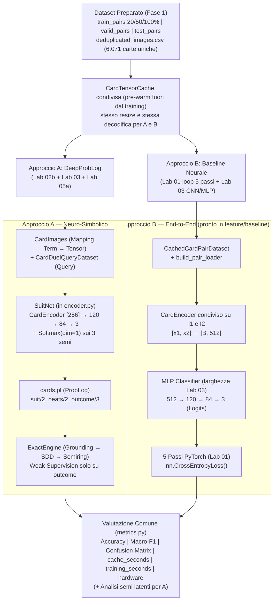

# Schema Operativo Completo: Approccio A (DeepProbLog) vs Approccio B (Baseline)

Questo documento fornisce lo **schema architetturale, i file e i template di codice** per entrambi gli approcci di *CardSeedDuel*, derivati dai notebook dei laboratori del corso (`Labs/Lab 01` – `Lab 05`) e collegati ai dati preparati nella Fase 1.

---

## 1. Vista d'Insieme: Architettura Parallela (Confronto Equo)

Entrambi gli approcci partono dagli **stessi CSV**, condividono **cache in RAM (`CardTensorCache`)**, **trasformazioni** (`build_image_transform` + `(x - 0.5) / 0.5`), **blocco visivo (`CardEncoder`, stile `Lab 03`)**, **metriche (`metrics.py`)** e **reporting hardware**.



---

## 2. Mappa dei File e Riferimenti Esatti ai Laboratori

| Modulo / File | Approccio | Stato | Riferimento Esatto in `Labs` |
| :--- | :---: | :---: | :--- |
| `src/card_suit_duel/models/encoder.py` (`CardEncoder`, `SuitClassifier`, `SuitNet`) | **Condiviso + A** | ✅ Pronto | **Lab 03** (`MNIST_Net` + `MNIST_Classifier`: `Conv(6)->Conv(16)`, `256->120->84->n` + `Softmax`, norm `[-1,1]`; stessa CNN ripresa in Lab 04 `Net` e Lab 05 `MNIST_Net`) |
| `src/card_suit_duel/models/metrics.py` (`compute_classification_metrics`, `collect_hardware_info`) | **Condiviso** | ✅ Pronto | Protocollo comune + hardware per confronto tempi |
| `src/card_suit_duel/models/baseline.py` (`BaselineDuelNet`) | **B** | ✅ Pronto | **Lab 03** (encoder + testa `120->84->3`), **Lab 04** (`examples/mnistAdd/baseline/network.py`) |
| `src/card_suit_duel/models/baseline_trainer.py` (`CardTensorCache`, `CachedCardPairDataset`, trainer) | **Condiviso + B** | ✅ Pronto | **Lab 01** (ciclo 5 passi `zero_grad->forward->loss->backward->step`; nel Lab 01 la rete era `DeepMLP_pytorch` `16->8->1` Sigmoid sulla parità 10-bit) |
| `scripts/train_baseline.py` & `tests/test_baseline.py` | **B** | ✅ Pronto | Test unitari + CLI con `--evaluate-test` OFF di default |
| `src/card_suit_duel/logic/cards.pl` | **A** | 🛠️ Schema sotto | **Lab 02b** (ProbLog) + **Lab 03** (`addition.pl`) |
| `src/card_suit_duel/logic/deepproblog_adapter.py` | **A** | 🛠️ Schema sotto | **Lab 03** (`MNISTImages` + `AdditionDataset`) |
| `src/card_suit_duel/logic/deepproblog_trainer.py` & `scripts/train_deepproblog.py` | **A** | 🛠️ Schema sotto | **Lab 03** (`Model`, `ExactEngine`, `train_model`, `Var("X")`) |
| `tests/test_logic.py` | **A** | 🛠️ Schema sotto | **Lab 02b** (verifica 9 combinazioni di semi) |

*(Per le slide teoriche: **Lab 05a** spiega la compilazione SDD e il WMC dietro `ExactEngine`; **Lab 04** fornisce la relazione $Acc_{\text{coppia}} \approx p^2$ e il confronto con NeurASP; **Lab 05b** il confronto con Semantic Loss senza overhead simbolico a test-time).*

---

## 3. Schema Pronto per l'**Approccio A — DeepProbLog**

### 3.1 Prerequisito ambiente (da `Labs/requirements.txt`)
```powershell
.venv\Scripts\python.exe -m pip install problog==2.3.0 PySDD==1.0.6
.venv\Scripts\python.exe -m pip install -e "..\Labs\Lab 03\deepproblog"
```

### 3.2 Programma Logico (`src/card_suit_duel/logic/cards.pl`)
```prolog
% Predicato neurale: mappa il tensore immagine X nella distribuzione Softmax sui 3 semi.
nn(suit_net, [X], S, [hearts, clubs, spades]) :: suit(X, S).

% Regole deterministiche del gioco (Cuori > Fiori > Picche > Cuori).
beats(hearts, clubs).
beats(clubs, spades).
beats(spades, hearts).

% Esito del duello dal punto di vista del Giocatore 1.
outcome(X, Y, p1_win) :- suit(X, S1), suit(Y, S2), beats(S1, S2).
outcome(X, Y, p2_win) :- suit(X, S1), suit(Y, S2), beats(S2, S1).
outcome(X, Y, draw)   :- suit(X, S),  suit(Y, S).
```

### 3.3 Rete Percettiva (`SuitNet`) — **già pronta in `encoder.py`**
L'Approccio A importa direttamente la rete già implementata e testata in [encoder.py](file:///c:/Users/ernes/Desktop/Neurosymbolic%20AI/Foundations%20of%20NESY/CardSeedDuel/src/card_suit_duel/models/encoder.py), garantendo **identico `CardEncoder` e identica normalizzazione `[-1, 1]`** rispetto alla Baseline:

```python
from card_suit_duel.models import CardEncoder, SuitNet

suit_net = SuitNet(encoder=CardEncoder())  # 256 -> 120 -> 84 -> 3 + Softmax(dim=1)
```

### 3.4 Ponte Simbolo-Tensore con **stessa `CardTensorCache`** (`deepproblog_adapter.py`)
Riutilizza `CardTensorCache` da `card_suit_duel.models` così che cache, pre-warming (`cache_seconds`) e trasformazioni siano **identici** tra Approccio A e B:

> ⚠️ **Due accorgimenti tecnici emersi dal Lab 03:**
> 1. **Indici interi in Prolog (`Constant(idx)`):** evita stringhe con spazi/slash nei termini Prolog.
> 2. **Atomi Prolog con `Term(...)`:** `p1_win`, `p2_win`, `draw` sono atomi Prolog → usare `Term(pair.outcome.value)`, non `Constant(...)`.

```python
from collections.abc import Iterator, Mapping, Sequence
from deepproblog.dataset import Dataset
from deepproblog.query import Query
from problog.logic import Constant, Term
from torch import Tensor

from card_suit_duel.data.mapping.schema import CardImage
from card_suit_duel.data.pairs.schema import CardPair
from card_suit_duel.models import CardTensorCache


class CardImages(Mapping[Term, Tensor]):
    """Ponte Term -> Tensor per DeepProbLog appoggiato sulla stessa CardTensorCache di B."""

    def __init__(self, cards: Sequence[CardImage], tensor_cache: CardTensorCache) -> None:
        self.cards = tuple(cards)
        self.tensor_cache = tensor_cache
        self.id_to_index = {card.image_id: idx for idx, card in enumerate(self.cards)}

    def prewarm_cache(self) -> float:
        return self.tensor_cache.prewarm(self.cards)

    def __len__(self) -> int:
        return len(self.cards)

    def __iter__(self) -> Iterator[int]:
        return iter(range(len(self.cards)))

    def __getitem__(self, item) -> Tensor:
        return self.tensor_cache.get(self.cards[int(item[0])])


class CardDuelQueryDataset(Dataset):
    """Genera Query di weak supervision solo sull'esito finale (stile AdditionDataset Lab 03)."""

    def __init__(
        self,
        pairs: Sequence[CardPair],
        split_name: str,
        id_to_index: Mapping[str, int],
    ) -> None:
        super().__init__()
        self.pairs = tuple(pairs)
        self.split_name = split_name
        self.id_to_index = id_to_index

    def __len__(self) -> int:
        return len(self.pairs)

    def to_query(self, i: int) -> Query:
        pair = self.pairs[i]
        t1 = Term("tensor", Term(self.split_name, Constant(self.id_to_index[pair.first_card.image_id])))
        t2 = Term("tensor", Term(self.split_name, Constant(self.id_to_index[pair.second_card.image_id])))
        return Query(Term("outcome", t1, t2, Term(pair.outcome.value)))
```

---

## 4. Protocollo Sperimentale Condiviso (20% / 50% / 100%)

| Parametro | Regola Condivisa | Note |
| :--- | :--- | :--- |
| **Scelta iperparametri (`image_size`, `epochs`, `lr`)** | **Solo su `valid`** | Il test set non si tocca durante sviluppo e tuning (`--evaluate-test` OFF di default) |
| **Pre-warming cache** | **Prima del training** | `cache_seconds` registrato a parte nel `summary.json` |
| **Misura tempi training** | **Solo forward / backward / update** | Con `torch.cuda.synchronize()` se `device=cuda` |
| **Blocco `hardware`** | Obbligatorio nel `summary.json` | CPU, thread PyTorch, versione PyTorch, GPU se presente (`collect_hardware_info`) |
| **Frazioni Training** | `20%` (`6.000`), `50%` (`15.000`), `100%` (`30.000`) | Stessa configurazione e stesso seed su tutte e 3 le frazioni; `valid` e `test` invariati |
| **Selezione Checkpoint** | Miglior **Macro-F1** su `valid` | Valutazione su `test` **una sola volta** a fine lavoro |

### Tabella Risultati Finali (da compilare dopo la valutazione finale unica su `test`)

| Frazione Train | A: Acc | A: Macro-F1 | A: Semi Latenti | A: Train Time | B: Acc | B: Macro-F1 | B: Train Time |
| :---: | :---: | :---: | :---: | :---: | :---: | :---: | :---: |
| **20%** (`6k`) | — | — | — | — | — | — | — |
| **50%** (`15k`) | — | — | — | — | — | — | — |
| **100%** (`30k`) | — | — | — | — | — | — | — |
