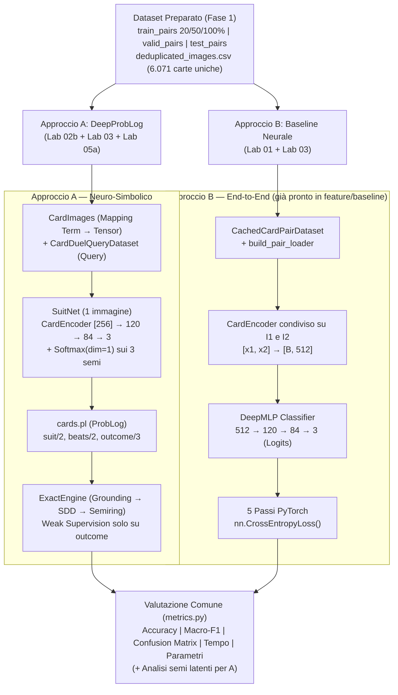

# Schema Operativo Completo: Approccio A (DeepProbLog) vs Approccio B (Baseline)

Questo documento fornisce lo **schema architetturale, i file e i template di codice pronti all'uso** per entrambi gli approcci di *CardSeedDuel*, derivati direttamente dai notebook dei laboratori del corso (`Labs/Lab 01` – `Lab 05`) e collegati al 100% ai dati preparati nella Fase 1.

---

## 1. Vista d'Insieme: Architettura Parallela (Confronto Equo)

Entrambi gli approcci partono dagli **stessi CSV**, applicano le **stesse trasformazioni** (`64×64`, `(x - 0.5) / 0.5`), usano lo **stesso blocco visivo** (`CardEncoder`, stile `MNIST_Net` del Lab 03) e vengono valutati con le **stesse metriche** (`metrics.py`).



---

## 2. Mappa dei File e Divisione Netta dei Moduli

| Modulo / File | Approccio | Stato | Rif. `Labs` |
| :--- | :---: | :---: | :--- |
| `src/card_suit_duel/models/encoder.py` (`CardEncoder`) | **Condiviso** | ✅ Pronto | `Lab 03` (`MNIST_Net.encoder`) |
| `src/card_suit_duel/models/metrics.py` | **Condiviso** | ✅ Pronto | `Lab 01` / `Lab 03` |
| `src/card_suit_duel/models/baseline.py` (`BaselineDuelNet`) | **B** | ✅ Pronto | `Lab 01` + `Lab 03` + `Lab 04` baseline |
| `src/card_suit_duel/models/baseline_trainer.py` | **B** | ✅ Pronto | `Lab 01` (ciclo 5 passi) |
| `scripts/train_baseline.py` & `tests/test_baseline.py` | **B** | ✅ Pronto | `Lab 01` |
| `src/card_suit_duel/logic/cards.pl` | **A** | 🛠️ Schema sotto | `Lab 02b` + `Lab 03` (`addition.pl`) |
| `src/card_suit_duel/models/suit_net.py` (`SuitNet`) | **A** | 🛠️ Schema sotto | `Lab 03` (`MNIST_Net` + `MNIST_Classifier`) |
| `src/card_suit_duel/logic/deepproblog_adapter.py` | **A** | 🛠️ Schema sotto | `Lab 03` (`MNISTImages` + `AdditionDataset`) |
| `src/card_suit_duel/logic/deepproblog_trainer.py` | **A** | 🛠️ Schema sotto | `Lab 03` (`Model`, `ExactEngine`, `train_model`) |
| `scripts/train_deepproblog.py` & `tests/test_logic.py` | **A** | 🛠️ Schema sotto | `Lab 03` (Celle 64, 74, 81, 84) |

---

## 3. Schema Pronto per l'**Approccio A — DeepProbLog**

### Prerequisito ambiente (da `Labs/requirements.txt`)
Nel `.venv` di `CardSeedDuel`, oltre a `torch==2.15.0` e `torchvision==0.29.2`, installare i pacchetti già verificati nei laboratori:
```powershell
.venv\Scripts\python.exe -m pip install problog==2.3.0 PySDD==1.0.6
.venv\Scripts\python.exe -m pip install -e "..\Labs\Lab 03\deepproblog"
```

---

### 3.1 Programma Logico (`src/card_suit_duel/logic/cards.pl`)
Adattamento diretto di `Labs/Lab 03/addition.pl`. L'ordine `[hearts, clubs, spades]` rispetta **esattamente** `SUIT_CLASSES` in `definitions.py`.

```prolog
% Predicato neurale: mappa il tensore immagine X nella distribuzione Softmax sui 3 semi.
nn(suit_net, [X], S, [hearts, clubs, spades]) :: suit(X, S).

% Regole deterministiche del gioco (Cuori > Fiori > Picche > Cuori).
beats(hearts, clubs).
beats(clubs, spades).
beats(spades, hearts).

% Esito del duello dal punto di vista del Giocatore 1.
outcome(X, Y, p1_win) :- suit(X, S1), suit(Y, S2), beats(S1, S2).
outcome(X, Y, p2_win) :- suit(X, S1), suit(Y, S2), beats(S2, S1).
outcome(X, Y, draw)   :- suit(X, S),  suit(Y, S).
```

---

### 3.2 Rete Percettiva (`src/card_suit_duel/models/suit_net.py`)
Adattamento diretto di `MNIST_Classifier` + `MNIST_Net` (`Lab 03`, Cella 13), riusando lo stesso `CardEncoder` della Baseline per garantire parità visiva.

```python
from torch import Tensor, nn

from card_suit_duel.data.mapping.definitions import SUIT_CLASSES
from card_suit_duel.models.encoder import CardEncoder


class SuitClassifier(nn.Module):
    """Testa MLP 256 -> 120 -> 84 -> 3 con Softmax obbligatoria per DeepProbLog."""

    def __init__(self, n: int = len(SUIT_CLASSES), size: int = 16 * 4 * 4) -> None:
        super().__init__()
        self.classifier = nn.Sequential(
            nn.Linear(size, 120),
            nn.ReLU(),
            nn.Linear(120, 84),
            nn.ReLU(),
            nn.Linear(84, n),
        )
        self.softmax = nn.Softmax(dim=1)

    def forward(self, x: Tensor) -> Tensor:
        return self.softmax(self.classifier(x))


class SuitNet(nn.Module):
    """Controparte diretta di MNIST_Net (Lab 03) per le 3 classi di semi."""

    def __init__(self, encoder: CardEncoder | None = None) -> None:
        super().__init__()
        self.encoder = encoder if encoder is not None else CardEncoder()
        self.classifier = SuitClassifier(
            n=len(SUIT_CLASSES),
            size=self.encoder.feature_dim,
        )

    def forward(self, x: Tensor) -> Tensor:
        # DeepProbLog con batching=True passa tensori [B, 3, H, W];
        # in caso di singola immagine [3, H, W] aggiungiamo la dimensione batch.
        if x.ndim == 3:
            x = x.unsqueeze(0)
        features = self.encoder(x)
        return self.classifier(features)
```

---

### 3.3 Ponte Simbolo-Tensore e Dataset di `Query` (`src/card_suit_duel/logic/deepproblog_adapter.py`)
Adattamento diretto di `MNISTImages` (Lab 03, Cella 32) e `AdditionDataset` (Lab 03, Cella 48), integrato con `CardImage` e `CardPair` della Fase 1.

> ⚠️ **Due accorgimenti critici emersi dal Lab 03:**
> 1. **Indici interi in Prolog:** associamo a ciascuna `CardImage` dello split un intero `0..N-1` (`Constant(idx)`), evitando stringhe con spazi/slash (`"train/ace of hearts/001.jpg"`) dentro i termini Prolog.
> 2. **Atomi Prolog con `Term(...)`:** `p1_win`, `p2_win`, `draw` sono atomi Prolog (non numeri), quindi vanno creati con `Term(pair.outcome.value)` e **non** con `Constant(...)`.

```python
from collections.abc import Callable, Iterator, Mapping, Sequence
from pathlib import Path

from PIL import Image
from deepproblog.dataset import Dataset
from deepproblog.query import Query
from problog.logic import Constant, Term
from torch import Tensor

from card_suit_duel.data.image_io import load_card_image
from card_suit_duel.data.mapping.schema import CardImage
from card_suit_duel.data.pairs.schema import CardPair
from card_suit_duel.data.preprocessing import build_image_transform


class CardImages(Mapping[Term, Tensor]):
    """Ponte Term -> Tensor per DeepProbLog con cache in RAM (stile MNISTImages Lab 03)."""

    def __init__(
        self,
        cards: Sequence[CardImage],
        dataset_root: Path,
        *,
        transform: Callable[[Image.Image], Tensor] | None = None,
    ) -> None:
        self.cards = tuple(cards)
        self.dataset_root = dataset_root
        self.transform = transform if transform is not None else build_image_transform(image_size=(64, 64))
        self.id_to_index = {card.image_id: idx for idx, card in enumerate(self.cards)}
        self._cache: dict[int, Tensor] = {}

    def __len__(self) -> int:
        return len(self.cards)

    def __iter__(self) -> Iterator[int]:
        return iter(range(len(self.cards)))

    def __getitem__(self, item) -> Tensor:
        # DeepProbLog passa item = term.args, es. (Constant(3),)
        idx = int(item[0])
        cached = self._cache.get(idx)
        if cached is not None:
            return cached
        with load_card_image(self.cards[idx], self.dataset_root) as img:
            tensor = self.transform(img)
        self._cache[idx] = tensor
        return tensor


class CardDuelQueryDataset(Dataset):
    """Genera Query di weak supervision solo sull'esito finale (stile AdditionDataset Lab 03)."""

    def __init__(
        self,
        pairs: Sequence[CardPair],
        split_name: str,
        id_to_index: Mapping[str, int],
    ) -> None:
        super().__init__()
        self.pairs = tuple(pairs)
        self.split_name = split_name
        self.id_to_index = id_to_index

    def __len__(self) -> int:
        return len(self.pairs)

    def to_query(self, i: int) -> Query:
        pair = self.pairs[i]
        idx1 = self.id_to_index[pair.first_card.image_id]
        idx2 = self.id_to_index[pair.second_card.image_id]

        t1 = Term("tensor", Term(self.split_name, Constant(idx1)))
        t2 = Term("tensor", Term(self.split_name, Constant(idx2)))
        outcome_atom = Term(pair.outcome.value)  # Term("p1_win") | Term("p2_win") | Term("draw")
        return Query(Term("outcome", t1, t2, outcome_atom))
```

---

### 3.4 Assemblaggio, Training e Valutazione (`deepproblog_trainer.py`)
Adattamento diretto delle Celle 38–42, 64, 74, 81 e 84 del **Lab 03**, collegato a `compute_classification_metrics` (`metrics.py`) così che Approccio A e B producano **report JSON identici**.

```python
import time
import torch
from deepproblog.dataset import DataLoader
from deepproblog.engines import ExactEngine
from deepproblog.model import Model
from deepproblog.network import Network
from deepproblog.query import Query
from deepproblog.train import train_model
from problog.logic import Constant, Term, Var

from card_suit_duel.data.mapping.mappings import (
    OUTCOME_DOMAIN,
    SUIT_DOMAIN,
    outcome_to_index,
    suit_to_index,
)
from card_suit_duel.models.metrics import compute_classification_metrics


def build_deepproblog_model(cards_pl_path, suit_net, tensor_sources, *, lr=1e-3):
    net = Network(suit_net, "suit_net", batching=True)
    net.optimizer = torch.optim.Adam(suit_net.parameters(), lr=lr)

    model = Model(str(cards_pl_path), [net])
    model.set_engine(ExactEngine(model))
    for split_name, source in tensor_sources.items():
        model.add_tensor_source(split_name, source)
    return model


def evaluate_deepproblog_outcomes(model: Model, dataset: CardDuelQueryDataset):
    """Valuta gli esiti con Var('X') + argmax (Lab 03 Cella 74) e calcola Accuracy + Macro-F1."""
    preds, targets = [], []
    start = time.perf_counter()
    model.eval()

    for i in range(len(dataset)):
        q = dataset.to_query(i)
        # Sostituisce il 3° argomento (outcome) con la variabile libera Var("X")
        img1, img2, true_atom = q.query.args
        eval_query = Query(Term("outcome", img1, img2, Var("X")))
        result = model.solve([eval_query])[0].result

        # Argmax sull'atomo predetto
        best_atom, _ = max(result.items(), key=lambda kv: float(kv[1].detach()))
        pred_name = str(best_atom.args[2])
        preds.append(outcome_to_index(pred_name))
        targets.append(outcome_to_index(str(true_atom)))

    elapsed = time.perf_counter() - start
    return {
        "elapsed_seconds": elapsed,
        **compute_classification_metrics(preds, targets, class_names=OUTCOME_DOMAIN),
    }


def evaluate_latent_suits(model: Model, cards, split_name: str, id_to_index):
    """Sanity check esclusivo di Approccio A (Lab 03 Cella 64): misura se SuitNet ha imparato i semi."""
    preds, targets = [], []
    model.eval()
    for card in cards:
        idx = id_to_index[card.image_id]
        img_term = Term("tensor", Term(split_name, Constant(idx)))
        res = model.solve([Query(Term("suit", img_term, Var("S")))])[0].result
        best_atom, _ = max(res.items(), key=lambda kv: float(kv[1].detach()))
        preds.append(suit_to_index(str(best_atom.args[1])))
        targets.append(suit_to_index(card.suit))
    return compute_classification_metrics(preds, targets, class_names=SUIT_DOMAIN)
```

---

### 3.5 Test delle 9 combinazioni (`tests/test_logic.py`)
Usa `problog` (Lab 02b) per verificare che `cards.pl` concordi al 100% con `determine_outcome` in `oracle.py` su tutte le $3 \times 3 = 9$ coppie di semi, prima ancora di addestrare una rete:
* Per ogni coppia `(s1, s2)` in `{hearts, clubs, spades}²`, sostituire il predicato neurale con fatti deterministici `1.0::suit(c1, s1). 1.0::suit(c2, s2).` e verificare che `P(outcome(c1, c2, expected)) == 1.0` e `0.0` per gli altri due esiti.

---

## 4. Schema dell'**Approccio B — Baseline Neurale** (Già Implementato)

Implementato sul branch `feature/baseline` seguendo **Lab 01** (`DeepMLP` + ciclo a 5 passi) e **Lab 03** (`CardEncoder`):

| Componente | File | Dettaglio |
| :--- | :--- | :--- |
| **Encoder condiviso** | [encoder.py](file:///c:/Users/ernes/Desktop/Neurosymbolic%20AI/Foundations%20of%20NESY/CardSeedDuel/src/card_suit_duel/models/encoder.py) | `(x - 0.5) / 0.5` → `Conv2d(3,6,5) → Pool → ReLU → Conv2d(6,16,5) → Pool → ReLU → AdaptiveAvgPool2d(4,4)` → `256` feature |
| **Modello Baseline** | [baseline.py](file:///c:/Users/ernes/Desktop/Neurosymbolic%20AI/Foundations%20of%20NESY/CardSeedDuel/src/card_suit_duel/models/baseline.py) | `BaselineDuelNet`: concatena `[x1, x2]` (`512`) → `Linear(512, 120) → ReLU → Linear(120, 84) → ReLU → Linear(84, 3)` (`74.851` parametri) |
| **Cache & Trainer** | [baseline_trainer.py](file:///c:/Users/ernes/Desktop/Neurosymbolic%20AI/Foundations%20of%20NESY/CardSeedDuel/src/card_suit_duel/models/baseline_trainer.py) | `CachedCardPairDataset` + `train_one_epoch` (5 passi con `CrossEntropyLoss`) + selezione best checkpoint su `valid` Macro-F1 |
| **CLI & Test** | [train_baseline.py](file:///c:/Users/ernes/Desktop/Neurosymbolic%20AI/Foundations%20of%20NESY/CardSeedDuel/scripts/train_baseline.py) | Supporta `--percentage {20,50,100}`, `--image-size 64`, `--epochs`, `--batch-size 64`, `--lr 0.001`; 8 test in [test_baseline.py](file:///c:/Users/ernes/Desktop/Neurosymbolic%20AI/Foundations%20of%20NESY/CardSeedDuel/tests/test_baseline.py) |

---

## 5. Protocollo Sperimentale Condiviso (20% / 50% / 100%)

Per rendere confrontabili i risultati di A e B nelle slide finali, entrambi gli approcci devono fissare questi parametri comuni:

| Parametro | Valore Condiviso | Note |
| :--- | :--- | :--- |
| **Risoluzione immagini** | `64 × 64` RGB (`float32`, `[-1, 1]`) | Bilancia nitidezza dei semi e velocità dell'ExactEngine |
| **Ottimizzatore & LR** | `Adam`, `lr = 1e-3` | Identico al Lab 03 (`MNIST_Net`) |
| **Batch Size** | `64` | Uguale in `build_pair_loader` (B) e `deepproblog.dataset.DataLoader` (A) |
| **Seed** | `42` | Fisso per inizializzazione pesi e shuffle |
| **Frazioni Training** | `20%` (`6.000`), `50%` (`15.000`), `100%` (`30.000`) | `valid` (`3.000`) e `test` (`3.000`) sempre identici e invariati |
| **Selezione Checkpoint** | Miglior **Macro-F1** su `valid` | Test set usato **una sola volta** a fine training |
| **Metriche esportate** | `accuracy`, `macro_f1`, `confusion_matrix`, `total_training_seconds`, `trainable_parameters` | Salvate in `summary.json` con schema identico |

### Tabella Finale da Compilare con i Run (Slide 8–9)

| Frazione Train | Approccio A: Acc | Approccio A: Macro-F1 | Approccio A: Semi Latenti Acc | Approccio A: Tempo | Approccio B: Acc | Approccio B: Macro-F1 | Approccio B: Tempo |
| :---: | :---: | :---: | :---: | :---: | :---: | :---: | :---: |
| **20%** (`6k`) | — | — | — | — | `69.63%` *(25 ep.)* | `0.6964` | `155.4 s` |
| **50%** (`15k`) | — | — | — | — | `84.97%` *(25 ep.)* | `0.8497` | `327.0 s` |
| **100%** (`30k`) | — | — | — | — | — | — | — |
